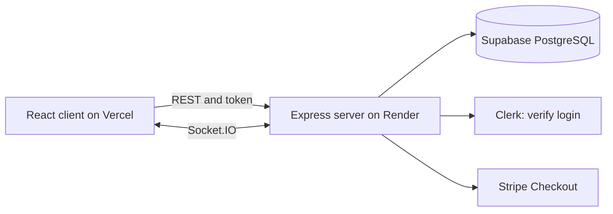

# RideNow: Server


Express and Socket.IO backend for a ride-hailing app (an Uber clone). It handles authentication checks, fares, driver matching, live updates, Stripe payments, receipts and reviews.


**Client repo:** [uber-clone-client](https://github.com/sruthi28021998/uber-clone-client)

## Screenshots

Click a link to open the screenshot.

1. [Server running (health check)](https://github.com/sruthi28021998/uber-clone-server/blob/main/docs/screenshots/01-health.png)
2. [Database tables (Supabase)](https://github.com/sruthi28021998/uber-clone-server/blob/main/docs/screenshots/02-database.png)
3. [Automated tests (26 passing)](https://github.com/sruthi28021998/uber-clone-server/blob/main/docs/screenshots/03-tests.png)
4. [GitHub Actions](https://github.com/sruthi28021998/uber-clone-server/blob/main/docs/screenshots/04-actions.png)
5. [Stripe sandbox payment](https://github.com/sruthi28021998/uber-clone-server/blob/main/docs/screenshots/05-stripe-payment.png)

## Tech stack
Node.js, Express, Supabase (PostgreSQL), Clerk, Socket.IO, Stripe Checkout, PDFKit, Nodemailer, Helmet, express-rate-limit, Vitest and Supertest

## Architecture


## Features
- Fare estimates for Standard, Premium and XL rides (calculated on the server, with a minimum fare)
- Ride booking, cancelling and status updates
- Driver matching within 10 km, where the first driver to accept gets the ride
- Real-time notifications to riders and drivers
- Stripe Checkout payments, verified directly with Stripe, with an 80% driver share recorded as earnings
- Ride history, PDF receipts and optional email receipts
- Ratings and reviews with driver average ratings
- Security: Helmet headers, rate limiting, input validation, request size limits, environment checks and row-level security on all tables

## Database
| Table | Purpose |
| --- | --- |
| `users` | Rider and driver profiles, driver online status and location |
| `rides` | Ride requests with locations, fare and status |
| `payments` | Payment records, driver earnings and platform fee |
| `reviews` | One review per ride |

The SQL files are in `supabase/`. Run them in the Supabase SQL Editor in this order: schema, day5, day8, day10, day12.

## Getting started
```bash
git clone https://github.com/sruthi28021998/uber-clone-server.git
cd uber-clone-server
npm install
cp .env   
npm run dev
```
The server runs at http://localhost:5000.

## Environment variables
| Name | Purpose |
| --- | --- |
| `CLIENT_URL` | Frontend URL for CORS and Stripe redirects (no trailing slash) |
| `CLERK_PUBLISHABLE_KEY`, `CLERK_SECRET_KEY` | Clerk keys |
| `SUPABASE_URL`, `SUPABASE_SERVICE_ROLE_KEY` | Supabase project URL and service key |
| `STRIPE_SECRET_KEY` | Stripe secret key (sandbox: `sk_test_...`) |
| `PAYMENT_MODE` | Set to `demo` for simulated payments when no Stripe key is set (local development only) |
| `SMTP_*`, `MAIL_FROM` | Optional, for receipt emails |

Never commit your `.env` file.

## Scripts
| Command | What it does |
| --- | --- |
| `npm run dev` | Start with auto-reload |
| `npm start` | Start for production |
| `npm test` | Run the 26 tests |

## API
| Method | Endpoint | Description |
| --- | --- | --- |
| GET | `/api/health` | Health check |
| GET, PATCH | `/api/users/me` | Current user and profile |
| GET | `/api/rides` | Ride history |
| GET | `/api/rides/estimate` | Fare estimate |
| POST | `/api/rides` | Request a ride |
| GET | `/api/rides/:id` | Ride details |
| PATCH | `/api/rides/:id/cancel` | Cancel a ride |
| PATCH | `/api/drivers/status` | Go online or offline |
| GET | `/api/drivers/rides/available` | Nearby requests |
| GET | `/api/drivers/rides/active` | Current ride |
| PATCH | `/api/drivers/rides/:id/accept` | Accept a ride |
| PATCH | `/api/drivers/rides/:id/status` | Start or complete a ride |
| POST | `/api/payments/checkout` | Create a Stripe Checkout session |
| POST | `/api/payments/confirm` | Confirm a payment with Stripe |
| GET | `/api/payments/earnings` | Driver earnings |
| GET | `/api/receipts/:id` | Receipt data |
| GET | `/api/receipts/:id/pdf` | Download receipt |
| POST | `/api/receipts/:id/email` | Email receipt |
| POST | `/api/reviews` | Review a driver |
| GET | `/api/reviews/driver/:id` | Driver rating and reviews |

All routes except the health check need a signed-in user.

## Payments
The rider clicks Pay and the server creates a Stripe Checkout session for the ride's fare. After paying on Stripe's page, the rider returns to the ride page, and the server asks Stripe whether the session was paid before marking the payment as succeeded. Test with card `4242 4242 4242 4242`.

## Project structure
```
src/
├── config/        env checks and Supabase client
├── lib/           fares, Stripe, receipts, PDF, mailer, realtime helpers
├── middleware/    authentication
├── routes/        users, rides, drivers, payments, receipts, reviews
├── socket.js      authenticated Socket.IO server
└── index.js       app setup
tests/             Vitest and Supertest tests
supabase/          SQL files
```

## Deployment
Deployed on Render as a Web Service: build command `npm install`, start command `npm start`, health check path `/api/health`, with all environment variables set.

On Render's free plan the server sleeps after a period without traffic, so the first request can take up to a minute.

Built by [@sruthi28021998](https://github.com/sruthi28021998)